# zookeeper-kafka-mesh

[](https://github.com/soloyes/zookeeper-kafka-mesh/actions/workflows/ci.yml)
[](LICENSE)

Grow and shrink a ZooKeeper ensemble and a Kafka cluster in Docker, one node at a time,
without stopping the service. Written in plain bash on top of the docker CLI; there is no
orchestrator underneath.

Starting a container is the easy part of adding a node. Every ZooKeeper node has to learn the
new `server.N` line, every broker needs the new `zookeeper.connect`, and every process has to
be restarted to pick up the change. If you restart them all at once you have an outage, and
if one of them does not come back you are left with half the nodes on the new config. These
scripts do it one node at a time:

* the new node gets its id (`myid` / `broker.id`) and its configuration, and is started and
  checked first;
* then the other nodes get the new configuration and are restarted one by one, each
  health-checked before the next one is touched;
* if any restart fails, every node changed so far gets its `.backup` configuration back and is
  restarted, and the new node is removed. The mesh ends up exactly as it was.

Removing a node works the same way in reverse: the node is stopped and the remaining nodes are
reconfigured and restarted one at a time. A broker is removed only after every partition is in
sync, and with a controlled shutdown, so its partition leadership moves to the other replicas
before it goes.

## Architecture

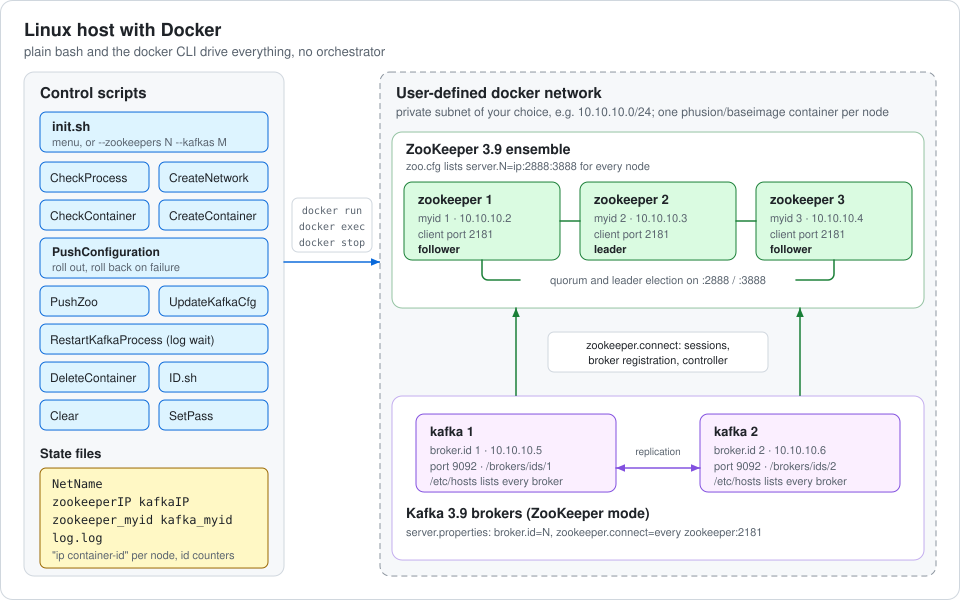

* Each node is its own container on a user-defined docker network with a private subnet you
  choose. The images are based on `phusion/baseimage` (a proper init, runit and sshd).
* ZooKeeper 3.9.1 comes from the Ubuntu 24.04 package; Kafka 3.9.1 runs in ZooKeeper mode.
* The scripts keep a little state next to themselves (`NetName`, `zookeeperIP`, `kafkaIP`,
  `*_myid`, `log.log`) and talk to the nodes only through `docker run / exec / stop`.
* Brokers advertise their hostname (the short container id), so every broker gets the other
  brokers in its `/etc/hosts`.

## Adding a node

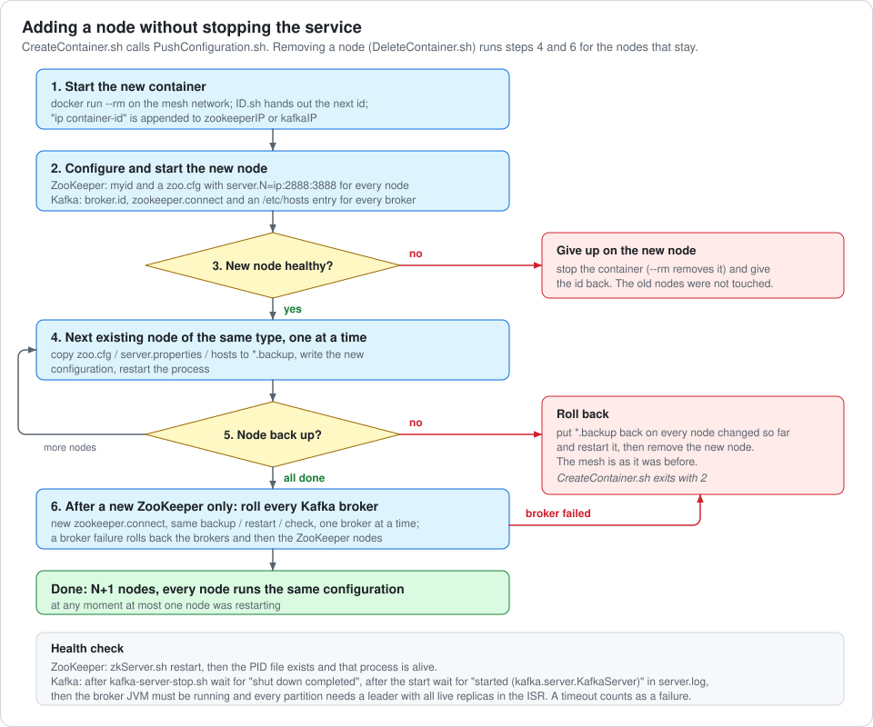

Health checks:

| Node | After a restart it counts as healthy when |
| --- | --- |
| ZooKeeper | `zkServer.sh restart` has written the PID file and that process is alive. Once the new server list is on every node, all nodes must answer `srvr` as leader, follower or standalone (90 s) |
| Kafka | `server.log` shows `shut down completed (kafka.server.KafkaServer)` after the stop, its `/brokers/ids/<id>` registration is gone from ZooKeeper, then `started (kafka.server.KafkaServer)` after the start (Kafka logs it once the broker is registered in ZooKeeper), the broker JVM is running, and every partition has a leader with all replicas on live brokers back in the ISR. Timeouts (90 s stop, 120 s start, 120 s sync) count as failures. |

Only log lines written after the command are looked at, so an old "started" line from a
previous run cannot fool the check.

## What it looks like

Real output from a macOS laptop (colima, arm64), with the scripts executed inside a Linux
`docker:cli` container the same way `tests/run-in-docker.sh` does it. Nothing was edited; the
`srvr` picture comes from a second run with the same steps, so its container ids differ.

Growing a fresh mesh to 3 ZooKeeper + 2 Kafka in one command. Each new node is checked first,
then the older nodes of the same type are restarted one at a time:

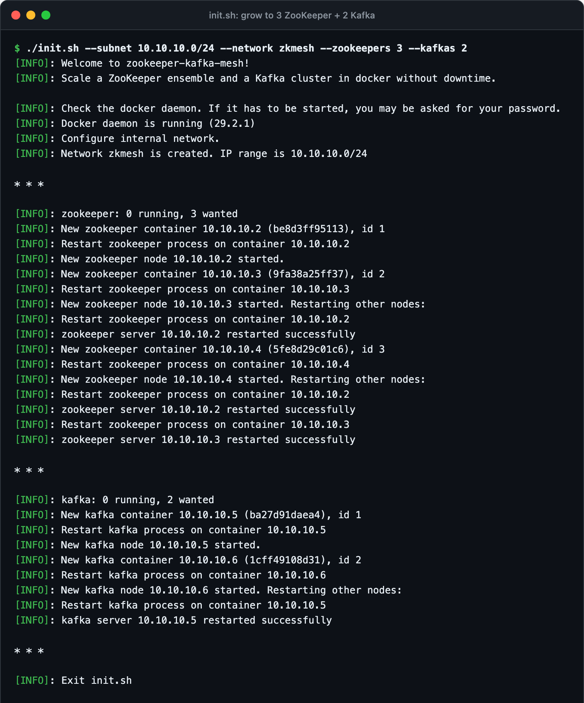

The live cluster: the five containers and the state files, `srvr` on each ZooKeeper node (two
followers and a leader), the brokers registered in ZooKeeper, and a topic with replication
factor 2 whose partitions are spread over both brokers. A message produced on broker 1 is read
on broker 2:

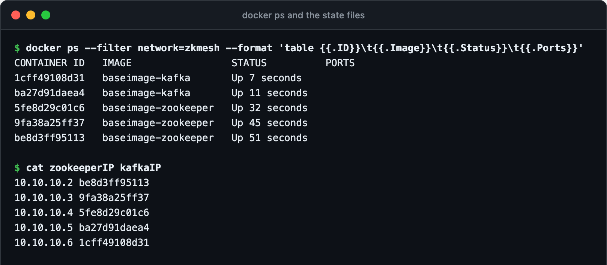

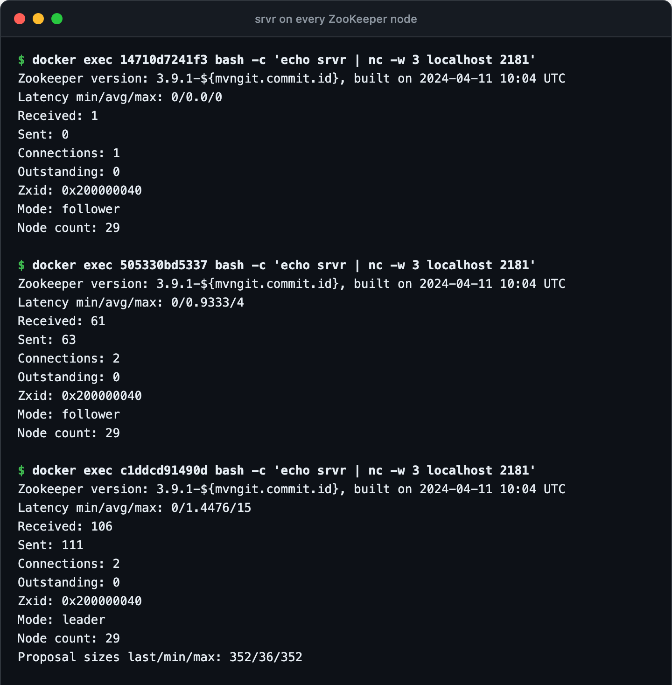

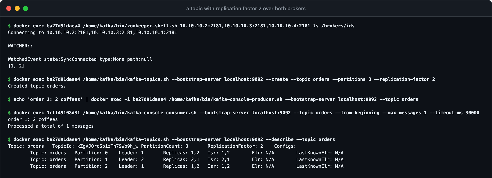

Shrinking to 2 + 1. The newest ZooKeeper is removed, the two that stay are restarted with the
shorter `server.N` list, both brokers get the shorter `zookeeper.connect`, and then the newest
broker is stopped with a controlled shutdown and removed. Afterwards every partition of the
topic is led by broker 1:

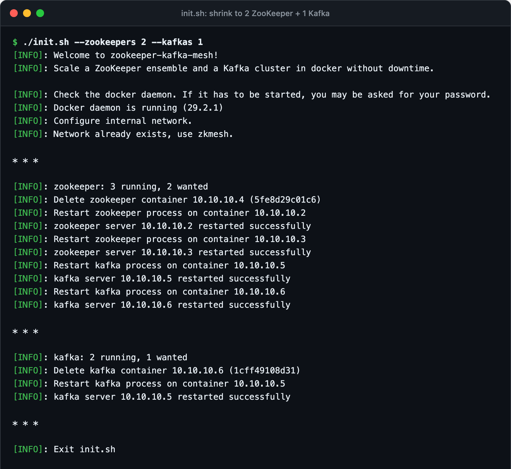

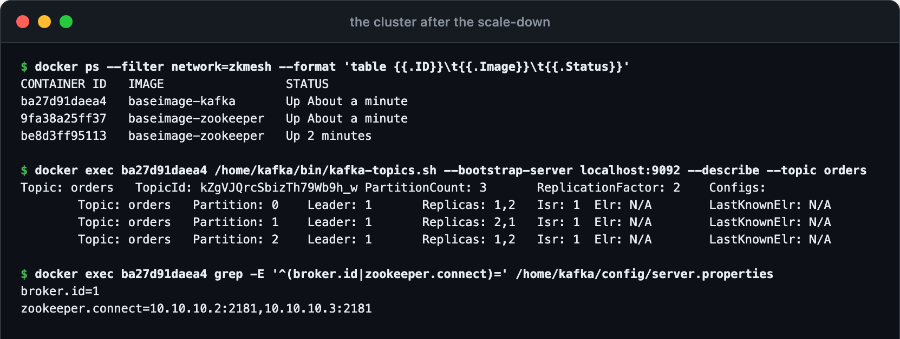

Growing back to 3 + 2. Adding a ZooKeeper node restarts the remaining broker with the longer
`zookeeper.connect`; adding a broker restarts the other broker so it learns the new host:

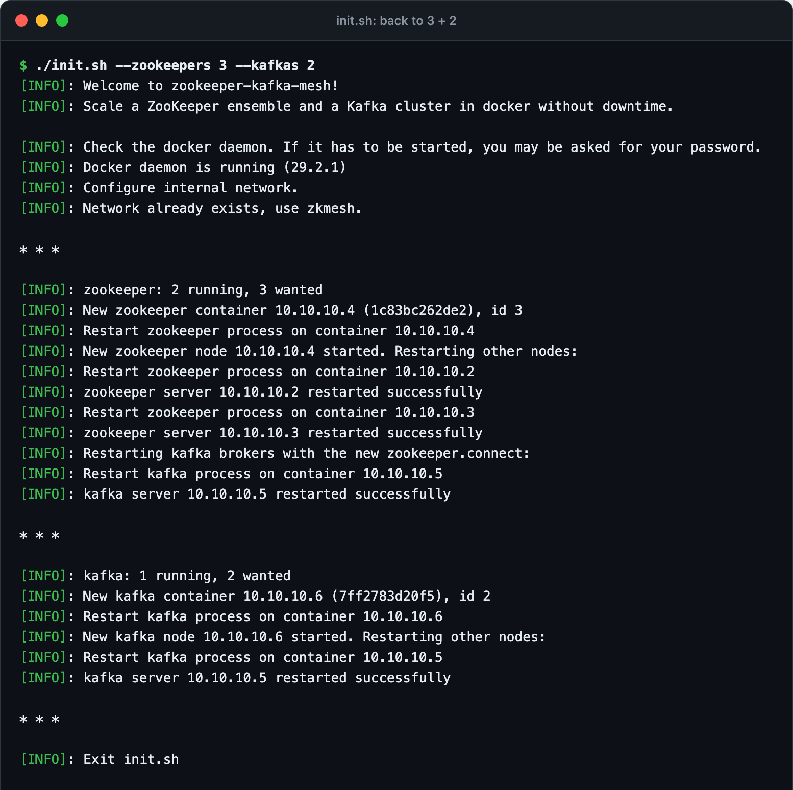

The interactive menu on top of an existing mesh, every question answered with No, and
`Clear.sh` at the end:

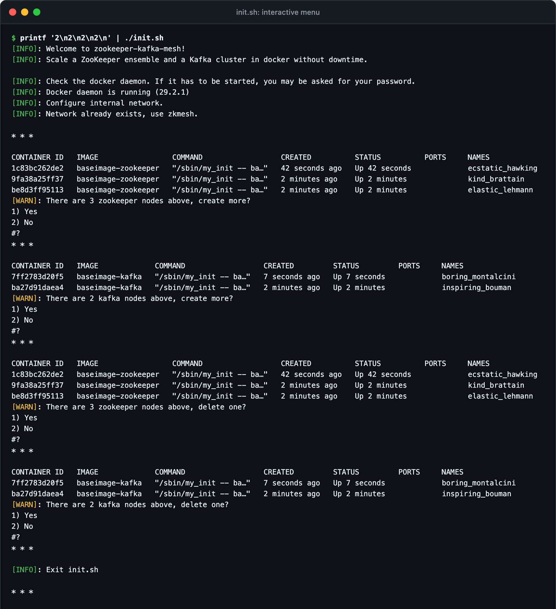

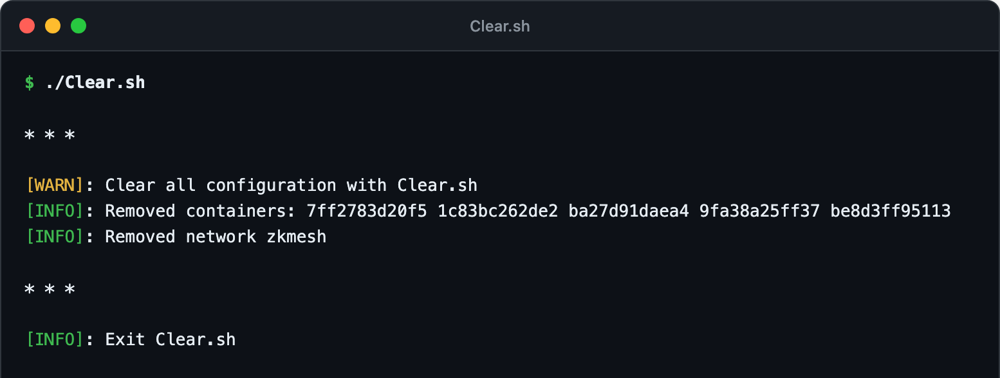

## Quick start

Requirements: Linux, bash, docker (your user can run `docker` without sudo), about 3 GB of
free RAM for 3 ZooKeeper + 2 Kafka nodes.

```bash
git clone https://github.com/soloyes/zookeeper-kafka-mesh.git
cd zookeeper-kafka-mesh

docker build -t baseimage-zookeeper -f DockerfileZ .
docker build -t baseimage-kafka -f DockerfileK .

./init.sh
```

`init.sh` checks the docker daemon, asks for a subnet (for example `10.10.10.0/24`) and a
network name, creates the first ZooKeeper node and then keeps asking whether to add another
ZooKeeper, add Kafka brokers, and remove a node. Run it again at any time to add or remove
nodes; it picks up the existing mesh from the state files and the running containers.

Look inside:

```bash
# ensemble state of every ZooKeeper node
for c in $(docker ps -q --filter ancestor=baseimage-zookeeper); do
  docker exec "$c" bash -c 'echo srvr | nc -w 3 localhost 2181' | grep Mode
done

# brokers registered in ZooKeeper
docker exec "$(docker ps -q --filter ancestor=baseimage-kafka | head -1)" \
  /home/kafka/bin/zookeeper-shell.sh "$(awk '{print $1":2181"}' zookeeperIP | head -1)" ls /brokers/ids
```

`./SetPass.sh` sets the root password of every node (`root`, or `$ZKM_ROOT_PASSWORD`), after
which `ssh root@<node ip>` works from the host. `./Clear.sh` removes all containers, the network
and the state files.

## Non-interactive mode

Give `init.sh` the numbers you want and it scales the mesh to them without asking anything.
Run it again with other numbers to add or remove nodes.

```bash
# create the network and grow to 3 ZooKeeper + 2 Kafka
./init.sh --subnet 10.10.10.0/24 --network zkmesh --zookeepers 3 --kafkas 2

# shrink to 2 + 1 (newest nodes are removed first)
./init.sh --zookeepers 2 --kafkas 1

# the same through the environment
ZKM_SUBNET=10.10.10.0/24 ZKM_NETWORK=zkmesh ZKM_ZOOKEEPERS=3 ZKM_KAFKAS=2 ./init.sh
```

| Option | Variable | Meaning |
| --- | --- | --- |
| `--subnet CIDR` | `ZKM_SUBNET` | subnet of the new network, inside 10.0.0.0/8, 172.16.0.0/12 or 192.168.0.0/16 |
| `--network NAME` | `ZKM_NETWORK` | name of the new network (default `zkmesh`) |
| `--zookeepers N` | `ZKM_ZOOKEEPERS` | wanted ZooKeeper nodes, at least 1 |
| `--kafkas N` | `ZKM_KAFKAS` | wanted Kafka brokers, 0 or more |
| | `ZKM_ROOT_PASSWORD` | password set by `SetPass.sh` (default `root`) |
| | `ZKM_KAFKA_STOP_TIMEOUT`, `ZKM_KAFKA_START_TIMEOUT`, `ZKM_KAFKA_SYNC_TIMEOUT` | Kafka health check timeouts in seconds (90 / 120 / 120) |
| | `ZKM_ZK_TIMEOUT` | seconds to wait for a ZooKeeper node to serve requests (90) |
| | `ZKM_KAFKA_SESSION_TIMEOUT` | seconds to wait for a stopped broker's registration to expire (60) |
| | `ZKM_DOCKER_RUN_OPTS` | extra `docker run` options for new nodes, e.g. `--cpus=0.25` to act like a slow machine |

## Scripts

| Script | What it does |
| --- | --- |
| `init.sh` | Entry point: interactive menu, or `--zookeepers` / `--kafkas` to scale to a size |
| `CheckProcess.sh` | Checks the docker daemon answers, tries to start it if not |
| `CreateNetwork.sh` | Creates the docker network (validated private subnet), saves its name to `NetName` |
| `CheckContainer.sh` | Rebuilds `zookeeperIP` / `kafkaIP` and the id counters from the running containers, asks create / delete |
| `CreateContainer.sh` | Starts one new node and joins it via `PushConfiguration.sh`; removes it again on failure |
| `PushConfiguration.sh` | Sets the new node's id, starts it, rolls the new configuration over the other nodes, rolls back on failure |
| `DeleteContainer.sh` | Removes the newest node of a type and reconfigures the rest one by one; removing the last ZooKeeper clears the mesh |
| `PushZoo.sh` | Rewrites the `server.N` list in `zoo.cfg` on one ZooKeeper node and restarts it |
| `UpdateKafkaCfg.sh` | Rewrites `zookeeper.connect` on one broker |
| `RestartKafkaProcess.sh` | Stops / starts one broker and waits for it in `server.log` |
| `ID.sh` | Hands out and gives back `myid` / `broker.id` values |
| `Clear.sh` | Removes every container on the network, the network and the state files |
| `SetPass.sh` | Sets the root password on every node for ssh access |
| `functions` | Shared helpers: logging, Yes/No prompt, node lookup, push / restore / health check |
| `tests/e2e.sh` | End-to-end test, see below |

## Testing

`tests/e2e.sh` builds both images and then:

1. grows a fresh mesh to 3 ZooKeeper + 2 Kafka with `init.sh`;
2. checks that every ZooKeeper node answers `srvr` with one leader and two followers, and that
   `/brokers/ids` in ZooKeeper is `[1, 2]`;
3. creates a topic with replication factor 2, produces a message on broker 1 and consumes it on
   broker 2;
4. shrinks to 2 ZooKeeper + 1 Kafka and checks again: leader + follower, `/brokers/ids` = `[1]`,
   the old message is still there and a new one goes through;
5. grows back to 3 + 2 and checks again, then tears everything down with `Clear.sh`.

```bash
tests/e2e.sh                 # on Linux
tests/run-in-docker.sh       # on macOS: copies the repo into a docker:cli container that uses the host daemon
```

GitHub Actions runs shellcheck and the end-to-end test on every push
([`.github/workflows/ci.yml`](.github/workflows/ci.yml)).

## Limitations

* Linux only. The scripts call `docker exec` into the nodes and never need to reach a node
  over the network from the host, but they are tested with Linux userland only. On macOS use
  `tests/run-in-docker.sh` or run `init.sh` the same way inside a Linux container.
* Not for production. Nodes keep their data inside the container (no volumes), sshd is
  enabled with a root password, and there is no TLS or authentication anywhere.
* ZooKeeper membership is static. Every change rewrites `zoo.cfg` and restarts the nodes;
  ZooKeeper's dynamic reconfiguration is not used. While the ensemble has only 1 or 2 nodes, a
  restart can cost the quorum for a few seconds (brokers reconnect on their own); from 3 nodes
  up one node restarting at a time leaves a majority running.
* Kafka runs in ZooKeeper mode. Kafka 3.9 is the last line that supports ZooKeeper; Kafka 4 runs
  KRaft only. Partitions are not moved when a broker is removed: topics need a replication
  factor above 1 to survive it, and the internal `__consumer_offsets` topic uses the default
  replication factor of 1.
* Removal has no rollback. The removed node is already gone, so if a remaining node does not
  come back the scripts report it and leave it to you.
* Nodes are removed newest first, which keeps the id counters consistent.
* The health checks look at processes and logs, not at client traffic.

## History

Written in 2017 as an interview task for Infobip: an interactive bash menu that scales
ZooKeeper and Kafka containers without interrupting the service. Revived and finished in 2026:
pinned and working images (the original Kafka 0.8.2.1 download mirror was long gone), bug
fixes, shellcheck-clean scripts, a non-interactive mode, an end-to-end test and CI.

## License

[MIT](LICENSE) © 2017-2026 Vitalii Solovev
